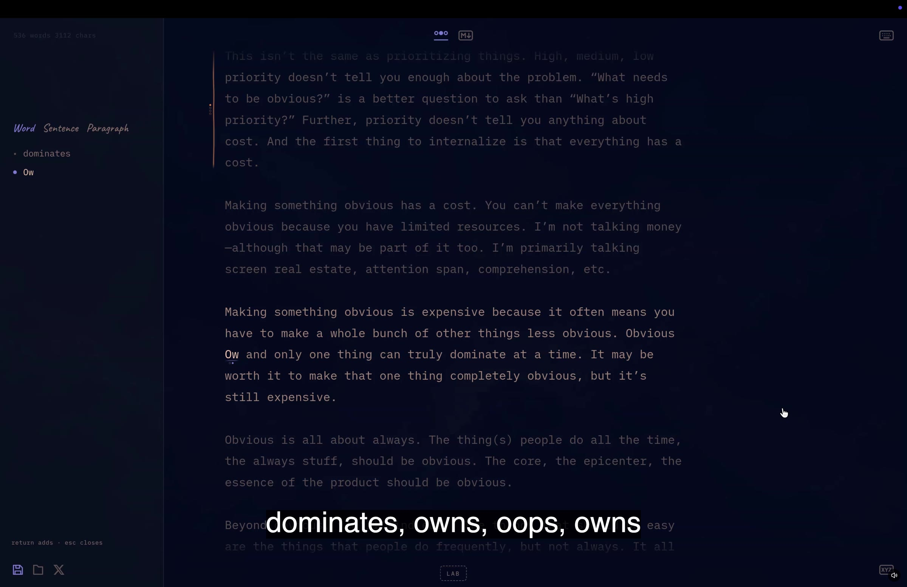
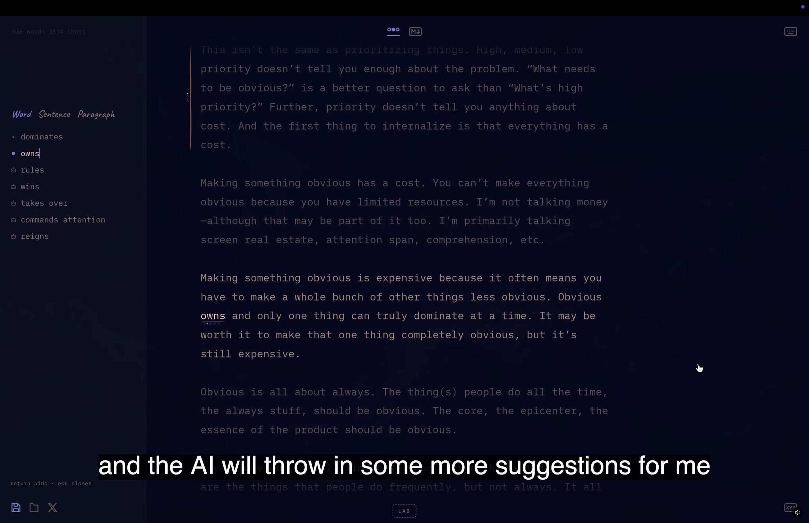
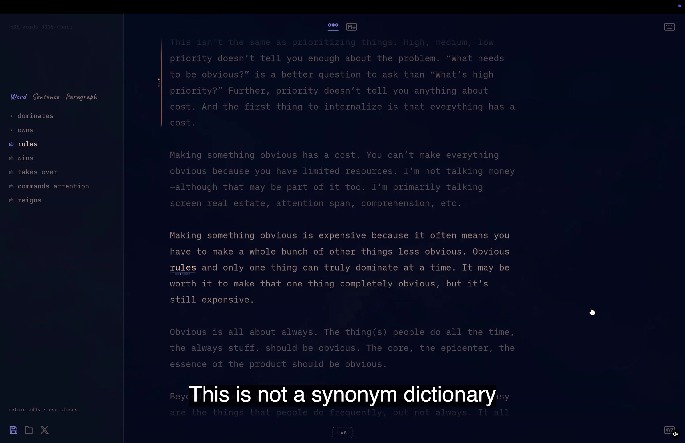
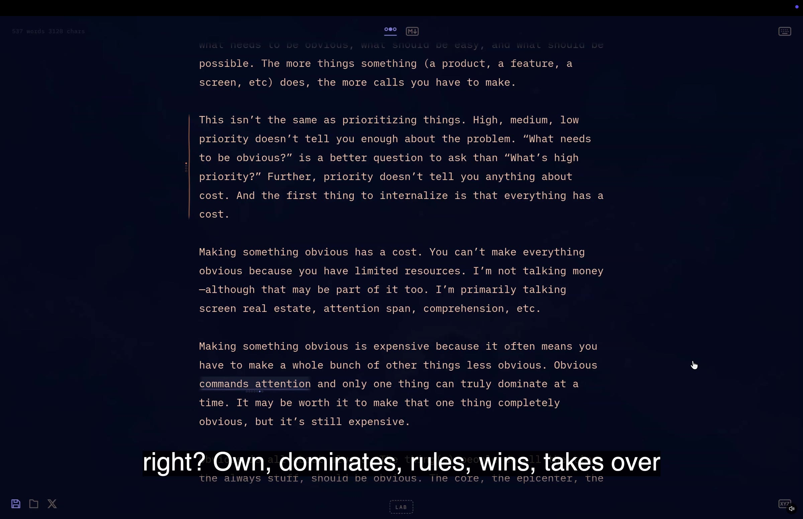
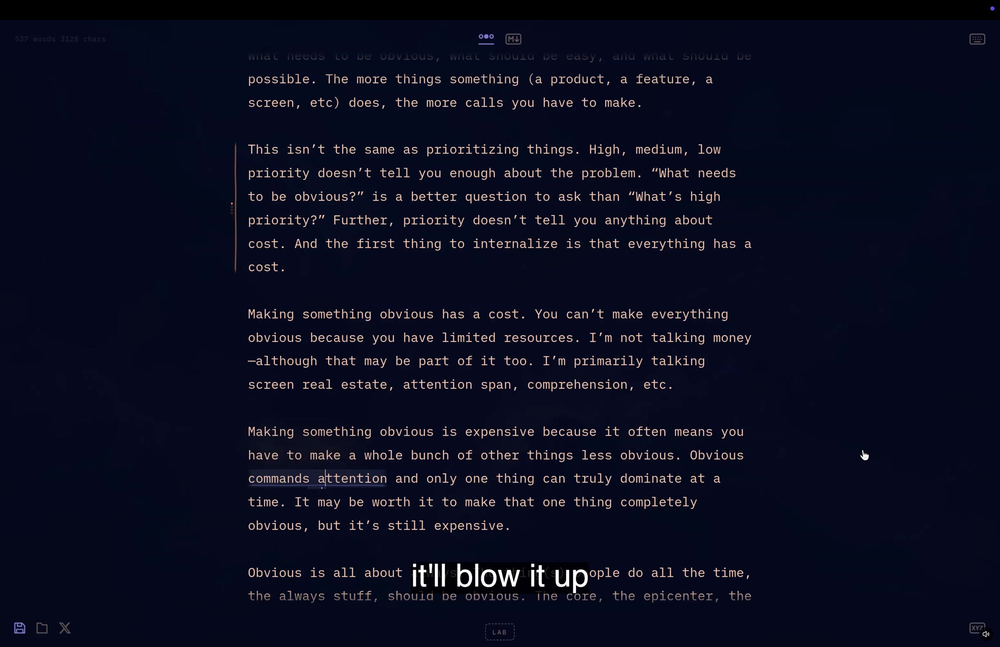

# Example 2: typing alternatives and "??" AI suggestions (1:05)

Same app as example 1, a separate short demo. The recording starts mid-sentence at about 0:22 of a 1:26 video. Timestamps are seconds into `example-2.mov`. Full speech is in `transcript.md`; every 3 seconds is in `../contact-sheets/s2_*.jpg`.

Setup: the word-alternatives side panel (Word | Sentence | Paragraph tabs) is already open on the left. The sentence being edited is "Obvious dominates and only one thing can truly dominate at a time."

## 0:00-0:10 Typing your own alternative

The list starts with "dominates" and an empty new entry. He types "Ow..." and the word in the sentence changes live as he types ("Obvious Ow and only one thing..."). He finishes "owns". "I don't know what other suggestions I would have." A new blank entry appears under it each time.

## 0:07-0:18 Ask the AI with "??"

If he cannot think of any more, he types `??` as a new entry. "It'll do a little dance" and the AI adds more: rules, wins, takes over, commands attention, reigns. The additions have a robot icon, his own entries a small square, and the current entry a filled blue dot. The frame also shows the word count at top left (536 words) and the pager dots under "owns" in the text.

## 0:18-0:35 Context, not a thesaurus

This works for words, sentences and paragraphs. "This is not a synonym dictionary. It's pulling in words based on the context of where it is in a sentence, the rest of the sentence and the rest of the paragraph that it lives in."

## 0:35-0:50 Reading each option in place

He scrolls to the same sentence and arrows through the list: owns, dominates, rules, wins, takes over, commands attention. The sentence reflows with each one ("Obvious commands attention and only one thing can truly dominate..."). The panel closes and the document is back to normal.

## 0:50-0:58 Deleting an alternative

"If there's one here I don't like, like 'takes over' is not what I would ever say, if I hit delete, it'll blow it up. If I undo it, it'll come back." This is described, not clearly shown: the panel is closed in the frame and the sentence shows "commands attention". By 0:54 the sentence reads "takes over" again after the undo.

## 0:58-1:05 Closing
He calls the panel a "fun little effect" and ends with "Good software is good. Great software is fun."
